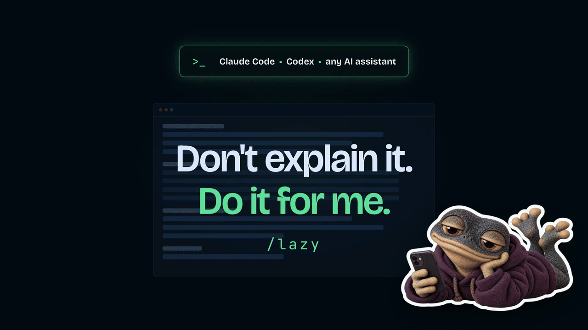

<p align="center">
  
</p>

# Lazy

> **Do it for me.**

A portable, one-shot skill for Claude Code, Codex, other AI coding assistants, and regular AI chats.

Use it when the assistant answers with steps for you to follow — "run this command", "go to the dashboard and click…", "add this setting" — and you would rather it did them itself.

## How to use

Invoke Lazy right after the suggestion you don't want to carry out yourself:

```txt
/lazy                          # Claude Code: do what you just suggested
/lazy deploy it to preview     # Claude Code: say what to do
$lazy                          # Codex
```

| Where | Trigger |
| --- | --- |
| Claude Code | `/lazy` |
| Codex | `$lazy` |
| Other coding assistants | the form created at install time |
| Regular AI chat | paste the chat version once, then send `lazy` |

Each invocation handles one request. It does not activate a persistent mode.

## What it does

Lazy takes the action the assistant just suggested (or the one you describe after the command) and carries it out end to end. It:

- opens with one short line confirming what it is about to do, so you know it understood ("Got it, I'll do it myself: creating the GitHub repo…");
- finds the cleanest way to do it with what is already available: shell, files, connected MCP servers, official CLIs, browser control;
- does the work instead of describing it, then checks that it worked;
- reports in a few lines what was done and what, if anything, is left for you;
- when something is missing (an MCP server, a CLI, a sign-in, an access), does everything it can, then tells you exactly what to connect and how, and stops.

## What stays with you

Lazy does everything around these steps and hands you only the single remaining one:

- passwords, 2FA codes, API keys, payment details, sign-ins, and account creation;
- CAPTCHAs, terms, and consents;
- paying or moving money.

It also asks once before anything irreversible or outward-facing: sending a message, publishing or deploying to production, deleting data, pushing to a shared branch, or changing anything outside the current project.

## Limitations

- Lazy can only act with the tools the assistant actually has in that session. When a tool is missing, it tells you how to add it rather than pretending.
- The boundaries above are instruction-based. Your assistant's own permission settings still apply and are never bypassed.
- In a regular AI chat without tools, Lazy produces the finished result (text, file, command) ready to use instead of instructions.

## Install in Claude Code

Claude Code uses [`.claude/skills/lazy`](.claude/skills/lazy) and invokes it as `/lazy`.

### Assisted installation (recommended)

Paste [install-lazy-for-claude-code.md](prompts-for-installation/install-lazy-for-claude-code.md) into Claude Code. It checks the current documentation and your local setup before choosing a destination.

### Manual installation

Clone this repository, enter it, then link the skill into your personal skills folder:

```sh
mkdir -p "$HOME/.claude/skills"
ln -s "$PWD/.claude/skills/lazy" "$HOME/.claude/skills/lazy"
```

For a project-only install, copy `.claude/skills/lazy` into that project's `.claude/skills/` folder. Check the current [Claude Code skills documentation](https://code.claude.com/docs/en/skills) if these paths change.

## Install in Codex

The Codex skill is in [`.agents/skills/lazy`](.agents/skills/lazy) and is invoked as `$lazy`.

### Assisted installation (recommended)

Paste [install-lazy-for-codex.md](prompts-for-installation/install-lazy-for-codex.md) into Codex. It checks the current documentation and your local setup before choosing a destination.

### Manual installation

Clone this repository, enter it, then link the skill into your personal skills folder:

```sh
mkdir -p "$HOME/.agents/skills"
ln -s "$PWD/.agents/skills/lazy" "$HOME/.agents/skills/lazy"
```

For a project-only install, copy `.agents/skills/lazy` into that project's `.agents/skills/` folder. Check the current [Codex skills documentation](https://learn.chatgpt.com/docs/build-skills) if these paths change.

Codex uses `$lazy`, not a custom root slash command.

## Other AI assistants and regular chats

- For another coding assistant, paste [install-lazy-for-any-ai.md](prompts-for-installation/install-lazy-for-any-ai.md).
- For ChatGPT, Claude, Gemini, or another regular chat, paste [lazy-ai-chat-version.md](prompts-for-ai-chat/lazy-ai-chat-version.md) once, then send `lazy` after a suggestion.

## Repository structure

```txt
lazy/
├── README.md
├── LICENSE
├── .gitignore
├── .agents/skills/lazy/
│   ├── SKILL.md
│   └── agents/openai.yaml
├── .claude/skills/lazy/SKILL.md
├── prompts-for-installation/
│   ├── install-lazy-for-claude-code.md
│   ├── install-lazy-for-codex.md
│   └── install-lazy-for-any-ai.md
├── prompts-for-ai-chat/
│   └── lazy-ai-chat-version.md
└── assets/
    ├── lazy-demo.gif
    └── lazy-demo.mp4
```

## More AI workflow skills

Small, portable skills for Claude Code, Codex, and any AI assistant.

| Skill | What it does |
| --- | --- |
| [Noob](https://github.com/arthurglaizal/noob) | Turns the last AI answer into something immediately understandable. |
| [WaitGo](https://github.com/arthurglaizal/wait-go) | Batches your instructions, then executes only when you say go. |
| [Session Recap](https://github.com/arthurglaizal/session-recap) | Recaps what you did in the current session and what to pick up next. |
| [Ask Mode](https://github.com/arthurglaizal/ask-mode) | Lets you question your codebase without the assistant changing anything. |
| [AI Handoff](https://github.com/arthurglaizal/ai-handoff) | Packages the current context so another AI can continue the work. |
| [FYI](https://github.com/arthurglaizal/fyi) | Gives your assistant context without giving it a task. |

## Support

If you find my work useful, you can [buy me a coffee](https://ko-fi.com/arturo_ux) ☕️

## License

MIT — see [LICENSE](LICENSE).
